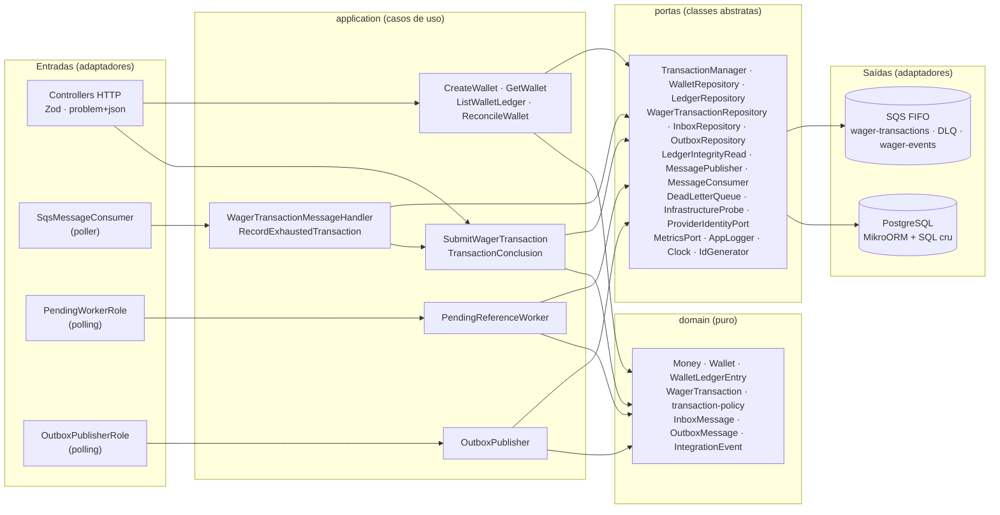
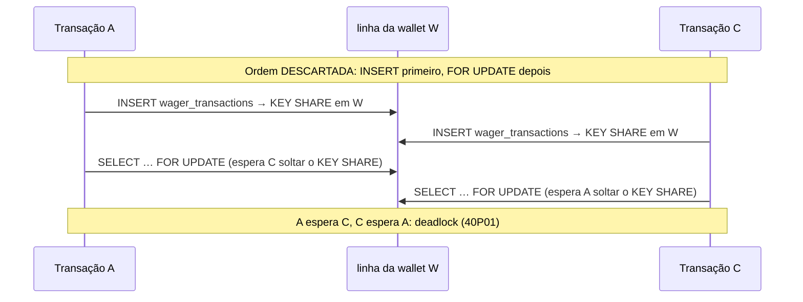
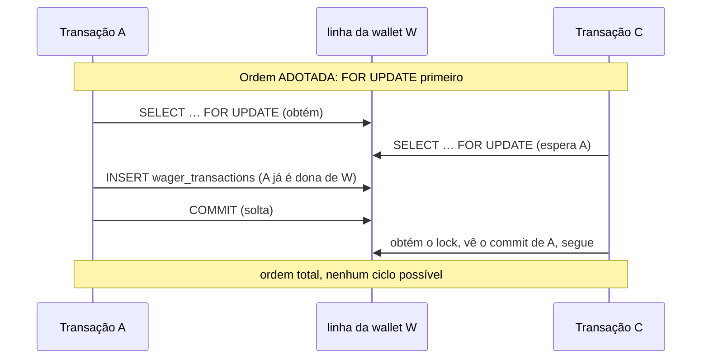

# ARCHITECTURE

Decisões de arquitetura, trade-offs e limitações do Distributed Wagering Processor. Este documento descreve **o que o código faz** (conferido no código e nos testes), não só o que a spec desenhou; onde a implementação difere do desenho, a diferença está dita. A origem de cada decisão está nos [ADRs](specs/adr/); o setup e os comandos estão no [README](README.md).

| Para ler sobre…                                     | Seção                                                      |
| --------------------------------------------------- | ---------------------------------------------------------- |
| Módulos, portas, papéis por instância               | [1](#1-visão-geral-e-módulos)                              |
| Por que MikroORM, mapeamento do `Money`, transações | [2](#2-orm-mikroorm-money-e-estratégia-transacional)       |
| Lock pessimista e alternativas descartadas          | [3](#3-concorrência)                                       |
| Ordem de locks e o deadlock de `KEY SHARE`          | [4](#4-ordem-canônica-de-locks)                            |
| Idempotência e `payloadHash`                        | [5](#5-idempotência)                                       |
| Ledger imutável e reconciliação                     | [6](#6-ledger-imutável-e-reconciliação)                    |
| Outbox, inbox, consumidor, DLQ, breaker, shutdown   | [7](#7-outbox-inbox-consumidor-dlq-breaker-e-shutdown)     |
| Referências fora de ordem                           | [8](#8-referências-fora-de-ordem)                          |
| `failureCode`, `errorCode` e status HTTP            | [9](#9-taxonomia-de-failurecode-e-errorcode-e-status-http) |
| Onde interpretei o enunciado                        | [10](#10-interpretações-do-enunciado)                      |
| Autenticação                                        | [11](#11-autenticação)                                     |
| Logs, métricas, health                              | [12](#12-observabilidade)                                  |
| Estratégia de testes                                | [13](#13-testes)                                           |
| O que não foi feito                                 | [14](#14-limitações-assumidas)                             |
| Evolução                                            | [15](#15-trade-offs-e-evolução)                            |

## 1. Visão geral e módulos

Arquitetura **hexagonal enxuta** ([ADR-0003](specs/adr/0003-arquitetura-hexagonal-e-topologia.md)), sem CQRS nem event sourcing. Quatro módulos, cada um com `domain/` (regras puras), `application/` (casos de uso e **portas**) e `infrastructure/` (adaptadores), mais `shared/` (`Money`, erros, `Clock`, ids UUIDv7, hash canônico, config Zod, seam de falha). `domain` e `shared` não importam `@mikro-orm/*` nem `@nestjs/*`, e `application` não importa `infrastructure`: um teste de arquitetura varre os imports (`TST-U-13`, [test/unit/architecture.test.ts](test/unit/architecture.test.ts)).



**Topologia.** Uma base de código e **uma imagem** ([Dockerfile](Dockerfile)). Toda instância executa os quatro papéis (HTTP, consumidor SQS, publisher da outbox, worker de referências), ligados e desligados por `ENABLE_*`; "três instâncias" e "dois publishers" são apenas réplicas. Nenhuma garantia vive na memória do processo: está no banco, o que torna a solução correta com N instâncias. O [Compose](docker-compose.yml) sobe Postgres, o emulador SQS, um serviço `migrate` de execução única (para as três instâncias nunca migrarem ao mesmo tempo) e `app1..3`.

**Domínio.** Construtores privados e fábricas (`create`, `open`, `rehydrate`; a reidratação não revalida transições). `WagerTransaction` tem máquina de estados explícita (`PENDING → PROCESSED | REJECTED | PENDING_REFERENCE | FAILED`; `PENDING_REFERENCE → PROCESSED | REJECTED | FAILED`; os três finais são terminais e a tentativa de transicioná-los lança `InvalidTransactionStateError`). `PENDING` nasce e termina dentro da mesma transação SQL, nunca é observável por fora. A decisão "aplicar, rejeitar ou aguardar" é a função pura `decideTransaction` ([transaction-policy.ts](src/modules/wagering/domain/transaction-policy.ts)); o caso de uso só fornece fatos (a referência, se já foi revertida) e persiste o resultado.

## 2. ORM: MikroORM, `Money` e estratégia transacional

> O enunciado (§4) pede a justificativa da escolha, do mapeamento do `Money` e da estratégia transacional aqui.

**Por que MikroORM** ([ADR-0002](specs/adr/0002-stack-bun-nestjs-mikroorm.md)). É o ORM preferido do enunciado e expõe o que o problema exige de forma explícita: `EntityManager.transactional()`, `LockMode` (inclusive `PESSIMISTIC_PARTIAL_WRITE`, que vira `FOR UPDATE SKIP LOCKED`), migrator com `up`/`down` e `EntitySchema` sem decorators (o domínio permanece puro). TypeORM, aceito pelo enunciado, foi descartado: `LockMode` e migrations menos ergonômicos e sem Identity Map. O spike confirmou o conjunto sob Bun (MikroORM 7.2.5, `@mikro-orm/nestjs` 7.1.0, Nest 12.3.2; [ADR-0002-spike](specs/adr/0002-spike.md)). Onde o ORM não expressa bem, o código usa **SQL cru parametrizado** (`em.execute`), permitido pelo ADR: `INSERT … ON CONFLICT DO NOTHING` sem alvo, `UPDATE wallets … WHERE id AND version`, acordar dependentes, "já foi revertida?" e o SQL da reconciliação. O ORM faz o `FOR UPDATE`, as leituras (sem Identity Map) e os inserts.

**Domínio separado da persistência** ([ADR-0004](specs/adr/0004-dominio-separado-da-persistencia.md)). O ORM mapeia modelos de dados (`WalletRow`, `WagerTransactionRow`, `LedgerEntryRow`, `InboxMessageRow`, `OutboxMessageRow`) por `EntitySchema`, e mappers convertem de e para o domínio via `rehydrate`. Mapear as classes de domínio direto faria a hidratação do ORM contornar os construtores privados.

**Como `Money` é mapeado** ([ADR-0005](specs/adr/0005-money-decimal.md)):

```
JSON da API/SQS  "25.00" ──Money.from──▶  Money (big.js, escala 2)  ──mapper──▶  coluna NUMERIC(19,2)
                  string     validado      imutável, nunca number     string      moeda em coluna `currency` à parte
```

- Entrada: regex `^\d+\.\d{2}$`, no máximo 17 dígitos inteiros (para caber em `NUMERIC(19,2)`; excesso é `400`, não `500`). `NaN`, `Infinity`, notação científica, vazio, mais de 2 casas e negativos são rejeitados. `Money` só nasce de **string validada**; não existe construtor a partir de `number`.
- Saída: sempre `toFixed(2)` (o `toString()` do big.js pode sair em notação exponencial). Eventos e contratos carregam `MoneyProps` (string), nunca a instância.
- Banco: `numeric(19,2)` mais `currency text`. O driver `pg` devolve `numeric` como string, então o valor **nunca** passa por `number` (o spike conferiu `"12345678901234567.89"`, além de 2^53, idêntico pela entidade, por `em.execute` e pelo `pg`). O schema de persistência declara `balance: string`.
- Como as entradas nunca têm mais de 2 casas, **não existe arredondamento**; a exatidão vem da escala fixa e da rejeição.
- `big.js` em vez de `bigint` em centavos: alinhado ao esqueleto do enunciado (`Decimal`); `bigint` também funcionaria.

**Estratégia transacional** ([ADR-0006](specs/adr/0006-concorrencia-lock-pessimista.md)). `READ COMMITTED` (o padrão do Postgres) **mais locks explícitos e constraints**: cada garantia tem um mecanismo nomeado e auditável (lock, `UNIQUE`, `CHECK`, trigger), em vez de depender de um isolamento implícito; `SERIALIZABLE` exigiria retry em toda a aplicação. O [`TransactionRunner`](src/modules/platform/infrastructure/transaction-runner.ts) abre `em.fork().transactional(...)` e emite `SET LOCAL lock_timeout` e `SET LOCAL statement_timeout` (5 s e 15 s por padrão; `SET LOCAL` evita vazar para a conexão do pool). O `EntityManager` da transação viaja num `AsyncLocalStorage`, de modo que as portas não recebem handle nenhum; um `run` aninhado entra na transação aberta (sem savepoint). Os erros do driver são traduzidos num único ponto: `55P03` → `lock_timeout`, `40P01` → `deadlock`, `57014` → `statement_timeout` (todos `TransientPersistenceError`); `57P01`, `57P03`, `08xxx` e pool esgotado → `InfrastructureUnavailableError`.

## 3. Concorrência

A unidade de concorrência é a **wallet**. Toda decisão que depende do saldo lê a wallet com `SELECT … FOR UPDATE` (`LockMode.PESSIMISTIC_WRITE`); as únicas leituras sem lock são os `GET` e a reconciliação, que são relatórios, não decisões. Não há lock global: cada operação toca uma só wallet (a referência precisa pertencer à mesma wallet), então wallets distintas andam em paralelo e não existe "ordem de locks entre wallets".

| Alternativa                                                | Veredito    | Por quê                                                                                                                                               |
| ---------------------------------------------------------- | ----------- | ----------------------------------------------------------------------------------------------------------------------------------------------------- |
| **A. `FOR UPDATE` na wallet**                              | **Adotada** | Determinística, sem retry, mantém `Wallet.debit()` como dona da regra de saldo                                                                        |
| B. Otimista (`version` + retry)                            | Descartada  | Em wallet quente vira tempestade de retries com trabalho refeito                                                                                      |
| C. `UPDATE … SET balance = balance − x WHERE balance >= x` | Descartada  | A regra de saldo passa para o SQL, `debit()` fica decorativo, e o lock da linha dura até o commit de qualquer forma (o ganho de velocidade é pequeno) |
| E. Fila single-writer por wallet                           | Evolução    | Libera o pool, mas é infraestrutura demais para o escopo (seção 15)                                                                                   |

**Defesas em profundidade** (se o lock falhar, o banco ainda barra):
1. `UPDATE wallets … WHERE id = $1 AND version = $esperada`: asserção que nunca deve falhar; se falhar é bug (`VersionAssertionError`, conta em `lock_conflicts_total{type="version_assert"}`) e **a correção não é adicionar retry**.
2. `CHECK (balance >= 0)`.
3. `UNIQUE (wallet_id, wallet_version)` no ledger.
4. `UNIQUE (provider_id, idempotency_key)` e `UNIQUE (provider_id, external_transaction_id)`.
5. `lock_timeout` e `statement_timeout`; ambos, e o deadlock, são falhas **transitórias** (HTTP 503 com `Retry-After`, retry no SQS).

**Custo assumido.** Transações da mesma wallet se serializam e seguram uma conexão do pool; por isso a transação é curta e **sem I/O externo** dentro dela (nenhuma chamada ao SQS no meio). O cenário obrigatório do enunciado (100,00 e duas apostas de 80,00) está em `TST-C-02`; a wallet quente (200 `BET` de 1,00 sobre 100,00 → exatamente 100 `PROCESSED`, saldo 0,00) em `TST-C-12`.

## 4. Ordem canônica de locks

> **Não alterar sem consultar o autor** ([ADR-0007](specs/adr/0007-ordem-de-locks-e-fluxo-transacional.md)).

**(1) inbox → (2) lock da wallet (`FOR UPDATE`) → (3) linhas e índices de `wager_transactions`.** Nenhuma transação adquire um recurso de nível menor depois de um de nível maior; como há ordem total, não há ciclo. Vale para HTTP, consumidor, worker de referências e reconciliação (esta não trava nada).

**O deadlock que a ordem evita.** Um `INSERT` em `wager_transactions` toma `FOR KEY SHARE` na linha da wallet (checagem da FK), e `KEY SHARE` **conflita com `FOR UPDATE`**. A primeira proposta ("inserir a transação, depois travar a wallet") produzia:





Consequências no código ([submit-wager-transaction.ts](src/modules/wagering/application/submit-wager-transaction.ts)):
- O fast path HTTP (leitura por chave de idempotência) é um `SELECT` simples **sem** `FOR`, antes de qualquer lock.
- No canal SQS, o inbox é inserido primeiro, **sem FK** (sem `KEY SHARE`): uma duplicata do mesmo `messageId` espera a primeira sem segurar nenhum lock.
- A referência é resolvida **depois** do lock da wallet: reversões da mesma wallet estão serializadas, então "já foi revertida?" não fica desatualizado.
- O mesmo `external_transaction_id` em wallets diferentes: o `INSERT` espera a transação com a linha não confirmada, mas esta não precisa da outra wallet, então não há ciclo (`TST-C-09`).
- O worker de referências **não** usa `SKIP LOCKED` na linha primeiro (inverteria a ordem): trava a wallet, relê a linha com `FOR UPDATE` e revalida.
- O `UPDATE` que acorda dependentes se restringe à wallet travada.
- Se mesmo assim o Postgres detectar `40P01`, é falha transitória.

**Provas.** `X-LOCK-ORDER` (`test/integration/submit-wager-transaction.test.ts`) registra o SQL real e reprova escrita ou lock em `wager_transactions` antes do lock da wallet; as mutações "`INSERT` antes do lock" e "linha antes da wallet no worker" derrubaram testes (relatórios W6 e W8). `TST-C-10` roda carga mista com 3 processos e confere `pg_stat_database.deadlocks` e `lock_conflicts_total{type="deadlock"}`: zero. O único deadlock deliberado da suíte é o teste `X-20` (cruza dois `FOR UPDATE` para provar a tradução de `40P01`).

## 5. Idempotência

Colunas na própria `wager_transactions` ([ADR-0008](specs/adr/0008-idempotencia.md)): uma só fonte da verdade, sem sincronizar tabelas.

| Coluna / constraint                                                         | Papel                                                                                                                                            |
| --------------------------------------------------------------------------- | ------------------------------------------------------------------------------------------------------------------------------------------------ |
| `idempotency_key` + `UNIQUE (provider_id, idempotency_key)`                 | Chave do header `Idempotency-Key` (fonte da verdade), com escopo por provedor                                                                    |
| `external_transaction_id` + `UNIQUE (provider_id, external_transaction_id)` | Necessário para resolver referências sem ambiguidade; mesmo id com outra chave → `409 EXTERNAL_TRANSACTION_ID_CONFLICT`                          |
| `payload_hash`                                                              | SHA-256 do conteúdo de negócio; mesma chave com hash diferente → `409 IDEMPOTENCY_KEY_PAYLOAD_MISMATCH`                                          |
| `observed_balance`                                                          | Saldo observado sob o lock no momento do resultado; é o que o replay devolve (`LOSS` e `REJECTED` não têm linha de ledger de onde reconstruí-lo) |

**Algoritmo do `payloadHash`** ([payload-hash.ts](src/modules/wagering/domain/payload-hash.ts), [hash.ts](src/shared/hash.ts)):
1. Montar o objeto com **exatamente** `providerId`, `externalTransactionId`, `playerId`, `walletId`, `roundId`, `gameId`, `kind`, `money{amount,currency}` (`amount` normalizado `"25.00"`) e `referenceExternalTransactionId` (omitido se ausente).
2. Canonicalizar: chaves em ordem lexicográfica (recursivo), sem espaços, strings pelo escape de `JSON.stringify`, UTF-8, propriedades `undefined` omitidas.
3. `SHA-256` do resultado, em hexadecimal minúsculo.

Ficam **fora** do hash: o header `Idempotency-Key`, `messageId`, `occurredAt`, `X-Correlation-Id` e qualquer metadado de transporte. A função só lê o subconjunto listado, então metadado não vaza para o hash. O hash é calculado **antes** de qualquer acesso ao banco.

**Duas camadas de deduplicação.** (a) O **inbox** `(consumer_name, message_id)` descarta a mesma mensagem SQS reentregue; seu `payload_hash` é o SHA-256 do JSON canônico do **corpo inteiro** da mensagem, e o mesmo `messageId` com corpo diferente vai para a DLQ. (b) A **chave de idempotência** descarta a mesma operação em mensagens ou canais diferentes: HTTP e SQS compartilham o espaço de chaves (`TST-I-11`).

**Fluxo.** Fast path (só HTTP, sem lock): se a chave já existe, responde replay ou conflito sem tocar na wallet. Senão, transação: `FOR UPDATE` da wallet → `INSERT … ON CONFLICT DO NOTHING` **sem alvo de conflito** (cobre a chave, o id externo e a PK de uma vez) → se nada foi inserido, relê com a wallet ainda travada (um novo comando enxerga o commit sob `READ COMMITTED`) e classifica: mesma chave e mesmo hash = replay; hash diferente = 409; só o id externo igual = 409. Com 50 requisições iguais em paralelo, todas esperam o lock; a primeira insere e as 49 seguintes batem na `UNIQUE`, releem e devolvem replay (`TST-C-01`, que também cobre o canal SQS).

**Replay com saldo observado.** O replay devolve o **resultado original** com `idempotentReplay: true`, e `balance` é o `observed_balance` gravado, não o saldo atual (`TST-I-07` confere que difere do atual depois de outras operações). O status do replay **segue o estado atual** da transação: um `PENDING_REFERENCE` que depois virou `PROCESSED` responde `200 PROCESSED`. Persiste após reinício do processo (`TST-C-08`, com `SIGKILL`).

## 6. Ledger imutável e reconciliação

**Imutabilidade no schema** ([ADR-0009](specs/adr/0009-ledger-imutavel.md)). Triggers que lançam exceção, válidos até para o dono da tabela (um `REVOKE` não protegeria contra ele):

| Objeto                  | Mecanismo                                                                                                                                                                                            |
| ----------------------- | ---------------------------------------------------------------------------------------------------------------------------------------------------------------------------------------------------- |
| `wallet_ledger_entries` | `ledger_no_row_change` (`BEFORE UPDATE OR DELETE`, por linha) e `ledger_no_truncate` (`BEFORE TRUNCATE`), ambos chamando `ledger_append_only()`                                                      |
| `wager_transactions`    | `wt_guard` (`wager_transactions_guard()`): `DELETE` proibido, linha em `PROCESSED`/`REJECTED`/`FAILED` imutável, colunas de identidade imutáveis                                                     |
| aritmética              | `CHECK le_arithmetic` (`balance_after = balance_before ± amount`), `amount > 0`, saldos ≥ 0                                                                                                          |
| unicidade               | `UNIQUE (wallet_id, transaction_id)` (no máximo um lançamento por wallet e transação) e `UNIQUE (wallet_id, wallet_version)` (ordem total por wallet; o cursor de paginação é a versão em base64url) |
| reversão única          | índice parcial `wt_one_reversal_per_reference` ([ADR-0010](specs/adr/0010-reversao-unica-por-referencia.md))                                                                                         |

Cuidados: `DROP TABLE` não dispara os triggers de linha, então um `down` que **apague linhas** precisa desabilitar o trigger antes (nenhum `down` atual apaga linhas; é testado com ledger populado, `TST-I-01`); `TRUNCATE` é bloqueado, por isso os testes usam banco novo por suíte. **Limite conhecido:** um superusuário que faça `SET session_replication_role = replica` não dispara triggers comuns (não foi usado `ENABLE ALWAYS`). O constraint trigger diferido "saldo = último `balance_after`" é stretch (S-02) e não foi feito: hoje a reconciliação e os testes cobrem esse risco.

**Reconciliação** ([ADR-0016](specs/adr/0016-reconciliacao.md), `POST /wallets/:id/reconciliation`):
- `calculatedBalance = SUM(CREDIT) − SUM(DEBIT)` sobre **todo** o ledger, independente do saldo armazenado (usar o último `balance_after` não detectaria um lançamento perdido).
- **Cadeia:** cada `balance_before` igual ao `balance_after` anterior, versões consecutivas, primeira entrada com `balance_before = 0` na versão 1 (abertura com saldo) ou 2 (wallet nascida zerada), última versão igual a `wallets.version`. Reporta `chain: { continuous, firstBreakAtVersion }`.
- `consistent` só é `true` se saldo = soma **e** a cadeia está íntegra.
- **Snapshot:** saldo e ledger vêm do mesmo instante, sem locks (não segura wallet quente). **Como foi implementado:** uma **única instrução SQL** ([ledger-integrity.reader.ts](src/modules/wallet/infrastructure/ledger-integrity.reader.ts)), que é um snapshot único mesmo em `READ COMMITTED`, e não uma transação `REPEATABLE READ READ ONLY` como o [04-api §5](specs/04-api.md) descreve; o ADR-0016 admite as duas formas. O teste de 40 reconciliações contra 40 `BET` concorrentes não produz falso positivo, e a mutação "dois statements" o derruba.
- **Nunca corrige:** divergência vira log de erro (`walletId`, `reason`, `firstBreakAtVersion`, nunca valores), `reconciliation_divergences_total`++ e `consistent: false` na resposta, que é sempre `200`. Corrigir apagaria a evidência.
- `assertLedgerInvariant`, chamada ao fim de todo teste de integração e concorrência, **é a mesma função** (`LedgerIntegrityReader`): se a reconciliação estivesse errada, os testes todos falhariam.

## 7. Outbox, inbox, consumidor, DLQ, breaker e shutdown

### Outbox ([ADR-0014](specs/adr/0014-outbox-e-eventos.md))

Na **mesma transação** do efeito financeiro entram de 1 a 3 linhas em `outbox_messages` (`id` = `eventId`, `group_key` = `walletId`, `payload` = envelope serializado com dinheiro em string). Eventos por cenário:

| Cenário                                                | Eventos                                              |
| ------------------------------------------------------ | ---------------------------------------------------- |
| `BET`/`WIN`/`REFUND`/`ROLLBACK` processados            | `WagerTransactionProcessed` + `WalletBalanceChanged` |
| `LOSS` processado                                      | `WagerTransactionProcessed`                          |
| Rejeição de negócio (inclui esgotamento de referência) | `WagerTransactionRejected`                           |
| Primeira entrada em `PENDING_REFERENCE` (uma vez)      | `WagerTransactionPendingReference`                   |
| `PENDING_REFERENCE` resolvida                          | `WagerTransactionProcessed` + `WalletBalanceChanged` |
| `FAILED` gravado (extensão)                            | `WagerTransactionFailed`                             |
| Replay · `OPENING`                                     | nenhum · só `WalletBalanceChanged`                   |

O [`OutboxPublisher`](src/modules/messaging/application/outbox-publisher.ts) roda por instância a cada `OUTBOX_POLL_MS`: numa transação, `SELECT … WHERE published_at IS NULL AND failed_at IS NULL AND next_attempt_at <= now() ORDER BY occurred_at LIMIT 10 FOR UPDATE SKIP LOCKED`, `SendMessageBatch` (timeout de 3 s) e marcação linha a linha. Como o publisher só enxerga linhas **commitadas**, nada é publicado antes do commit do efeito.

- **At-least-once.** Se o processo morre antes do commit do publisher, os locks somem e outra instância republica; o `eventId` é o mesmo. A fila `wager-events.fifo` usa `MessageGroupId = walletId` e `MessageDeduplicationId = eventId` (a deduplicação do SQS, janela de 5 min, é só otimização; a garantia vem do consumidor com inbox por `eventId`).
- **Erro transitório** (rede, throttling, 5xx, fila inexistente, erro não reconhecido): backoff exponencial de 1 s a 60 s, **sem limite de tentativas** (o evento é um fato financeiro confirmado). **Permanente** (mensagem acima do limite, parâmetro inválido): `failed_at` + `last_error`, `outbox_publish_failed_total`++ e log de erro. A classificação é por **lista de erros permanentes**; tudo fora dela é transitório, para nunca descartar um evento por engano.
- `outbox_lag_seconds` = idade do evento mais antigo ainda não publicado nem falho, inclusive os em backoff.
- Não há ordem global: dois publishers podem enviar eventos da mesma wallet fora de ordem; o consumidor ordena por `walletVersion`/`occurredAt` (seção 14).
- Nenhum serviço consome os eventos neste projeto; um consumidor de teste com inbox por `eventId` prova que a publicação duplicada é segura.

### Inbox e consumidor SQS ([ADR-0015](specs/adr/0015-inbox-consumidor-e-resiliencia.md))

O consumidor é um **poller próprio e fino** sobre `@aws-sdk/client-sqs`, atrás da porta `MessageConsumer` (controle do ack pós-commit, backoff por mensagem e shutdown). `ReceiveMessage` com até 10 mensagens e long polling de 20 s; o lote é agrupado por `MessageGroupId`: grupos diferentes em paralelo (até `SQS_CONCURRENCY`, 5), o mesmo grupo **em série**. Cada handler tem timeout de 20 s, abaixo da visibilidade de 30 s da fila. O handler **reutiliza `SubmitWagerTransaction`** (o mesmo caso de uso do HTTP) e o **mesmo schema Zod**, com `channel = "sqs"`: dentro da transação, insere o inbox primeiro, depois o fluxo financeiro, e marca o inbox como processado. **O ack (delete) só acontece depois do commit.**

### Cenários de falha

| Cenário                                                                                                                   | Comportamento                                                                                                                                                                                                                                                                       | Prova                                                       |
| ------------------------------------------------------------------------------------------------------------------------- | ----------------------------------------------------------------------------------------------------------------------------------------------------------------------------------------------------------------------------------------------------------------------------------- | ----------------------------------------------------------- |
| Processo morre **depois do commit e antes do ack**                                                                        | A visibilidade expira, a mensagem volta e o inbox a descarta: um único efeito                                                                                                                                                                                                       | `TST-C-05` (processo real, `crash-after-commit-before-ack`) |
| Processo morre depois do commit e antes de **publicar** o evento                                                          | Outra instância assume a linha da outbox e publica o mesmo `eventId`                                                                                                                                                                                                                | `TST-C-06`, `TST-I-13`                                      |
| Publisher morre **depois de enviar e antes do commit**                                                                    | Locks somem; outra instância reenvia o mesmo `eventId` (o FIFO colapsa dentro de 5 min; senão o consumidor deduplica)                                                                                                                                                               | `TST-C-06` (b), `TST-I-13`                                  |
| Mesmo `messageId` com **outro corpo**                                                                                     | Permanente: DLQ imediata                                                                                                                                                                                                                                                            | `TST-I-11`                                                  |
| `lock_timeout` (`55P03`), deadlock (`40P01`), `statement_timeout` (`57014`)                                               | Transitório **da mensagem**: não apaga; `ChangeMessageVisibility = min(30, 2·2^(n−1))` s, com `n` = recepções; as seguintes do mesmo grupo no lote são devolvidas (visibilidade 0)                                                                                                  | `TST-I-12`, `TST-U-11`                                      |
| Falha **permanente** (JSON/schema inválido, `type` desconhecido, `OPENING`, wallet inexistente, conflito de idempotência) | DLQ imediata com atributos `errorCode`/`reason`, depois delete; as seguintes do grupo seguem                                                                                                                                                                                        | `TST-I-12`                                                  |
| Falha desconhecida                                                                                                        | Tratada como transitória, limitada por `SQS_MAX_RECEIVE`; nunca descarte silencioso                                                                                                                                                                                                 | `TST-U-11`                                                  |
| **Exaustão** (`ApproximateReceiveCount >= 8`)                                                                             | O consumidor grava `FAILED` (`PROCESSING_ATTEMPTS_EXHAUSTED`) + evento `WagerTransactionFailed`, envia à DLQ e apaga; o redrive do SQS é só rede de segurança para quedas do processo. Sem lock livre ou sem banco, não há `FAILED`: a mensagem vai à DLQ, que é a fonte da verdade | `TST-I-12`                                                  |
| **Banco derrubado** durante o consumo                                                                                     | Abre o circuit breaker; o consumidor para de buscar (mensagem não recebida não consome tentativa); nada vai à DLQ; retoma quando `SELECT 1` passa                                                                                                                                   | `TST-I-20`                                                  |

### Circuit breaker

Só erros de **infraestrutura do banco** (conexão recusada, `57P01`/`57P03`/`08xxx`, pool esgotado, timeout de rede) abrem o breaker; `lock_timeout` e deadlock **não** (são da mensagem e consomem tentativas). Estados: fechado → aberto (cooldown exponencial de 1 s a 30 s) → semiaberto (uma sonda `SELECT 1`, timeout de 2 s) → fechado. Enquanto aberto, a readiness falha e `circuit_breaker_open` = 1. As falhas de rede do **SQS** não alimentam o breaker: o `receive` pausa 1 s e tenta de novo; delete e visibilidade falhos são logados (a mensagem volta e o inbox descarta).

### Shutdown ordenado (`SIGTERM`/`SIGINT`)

Implementado em [main.ts](src/main.ts): (1) a readiness passa a falhar (`LifecycleState.drain()`), (2) pausa opcional de `SHUTDOWN_DRAIN_DELAY_MS` com o listener ainda aberto, para quem observa tirar a instância de rotação (o Compose usa 2000 ms; o padrão é 0), (3) `app.close()`: o HTTP para de aceitar conexões e drena as em curso, o consumidor para de buscar e espera os handlers por até `SHUTDOWN_GRACE_MS` (20 s), e os que não terminaram têm a mensagem **devolvida** (visibilidade 0, sem apagar; se já tinham feito commit, o inbox descarta a reentrega), o publisher termina o lote atual, o worker de referências conclui a transação em curso, e o pool fecha. O `stop_grace_period` do Compose é 30 s. O código **não usa** `app.enableShutdownHooks()` do Nest: sob Bun ele reenvia o sinal ao processo, que termina com 143; `main.ts` instala o próprio handler e o processo sai com 0 por si só (prova de que nada ficou vivo). Prova: `TST-I-18`.

## 8. Referências fora de ordem

([ADR-0013](specs/adr/0013-referencias-fora-de-ordem.md)) Uma operação dependente (`REFUND`, `ROLLBACK`, ou `WIN`/`LOSS` com referência) pode chegar antes da transação referenciada. A referência é resolvida por (`providerId`, `referenceExternalTransactionId`) **sem filtro de wallet** e só depois se confere a wallet: uma `BET` de outra wallet gera `REFERENCE_MISMATCH` (terminal) em vez de esperar o backoff inteiro e terminar em `REFERENCE_NOT_FOUND`.

- Referência ausente → `PENDING_REFERENCE` (HTTP `202`) + evento `WagerTransactionPendingReference`, **uma vez**. Referência também `PENDING_REFERENCE` → esta fica pendente (cadeia); referência `REJECTED`/`FAILED` → `REFERENCE_NOT_PROCESSED`.
- **Backoff exponencial com jitter igual**: atraso `d = min(cap, base·fator^n)` e espera `d/2 + rand·d/2`, ou seja, em `[d/2, d)`. Padrão: **6 tentativas**, base 5 s, fator 2, teto 300 s, o que dá `d` = 5, 10, 20, 40, 80 e 160 s, ≈ 5 min no total (315 s sem jitter). Tudo configurável (`PENDING_REF_*`); nos testes, milissegundos.
- **Justificativa.** Referências fora de ordem costumam chegar em segundos (atraso de fila ou de rede entre sistemas do provedor); 5 minutos cobrem esse atraso sem deixar pendências por horas, e o jitter evita que pendências criadas juntas reentrem juntas. Esgotado o limite, o provedor recebe uma resposta definitiva (`REJECTED` `REFERENCE_NOT_FOUND` + `WagerTransactionRejected`) em vez de uma pendência eterna.
- O worker faz exatamente `PENDING_REF_MAX_ATTEMPTS` retentativas; a nova tentativa que continua pendente **não é transição** (incrementa `reference_attempts` e reagenda `next_attempt_at`).
- **Acordar dependentes:** ao processar uma transação, `next_attempt_at = now()` nos pendentes que a referenciam, **só da mesma wallet** travada, na mesma transação. Dependentes de outras wallets esperam o backoff e serão rejeitados por mismatch.
- **Worker** (a cada `PENDING_REF_POLL_MS`, 1 s; 5 wallets em paralelo): leitura sem lock dos candidatos vencidos; por candidato, em transação própria: `FOR UPDATE` da wallet → relê a transação com `FOR UPDATE` e **revalida** status e vencimento (cobre dois workers concorrentes: `TST-C-07` roda com dois workers ativos e a mutação "sem revalidar o vencimento" foi pega) → resolve. Os eventos do worker usam um `correlationId` novo por tentativa (não há requisição nem `messageId`).

## 9. Taxonomia de `failureCode` e `errorCode`, e status HTTP

`failureCode` significa "resultado de negócio **gravado**": quem o lê sabe que a transação existe no banco e é auditável. `errorCode` é um erro **não persistido** (`application/problem+json`, RFC 9457, com `errorCode`, `correlationId` e `retryable`). Ver [ADR-0011](specs/adr/0011-estados-e-codigos-de-falha.md) e [ADR-0012](specs/adr/0012-http-status-e-erros.md).

**`failureCode`** (enum em [failure-code.ts](src/modules/wagering/domain/failure-code.ts)):

| Código                          | Quando                                                                                       | Ação esperada do provedor                                                                         |
| ------------------------------- | -------------------------------------------------------------------------------------------- | ------------------------------------------------------------------------------------------------- |
| `INSUFFICIENT_FUNDS`            | `BET` sem saldo                                                                              | Desistir (nova aposta = nova chave)                                                               |
| `REVERSAL_WOULD_OVERDRAW`       | A reversão deixaria o saldo negativo                                                         | Escalar operacionalmente                                                                          |
| `REFERENCE_NOT_FOUND`           | A referência não apareceu após as tentativas                                                 | Corrigir ou escalar                                                                               |
| `REFERENCE_NOT_PROCESSED`       | Referência `REJECTED` ou `FAILED`                                                            | Desistir                                                                                          |
| `REFERENCE_ALREADY_REVERSED`    | Referência já revertida                                                                      | Desistir (já resolvido)                                                                           |
| `REFERENCE_MISMATCH`            | Player, wallet, moeda ou rodada divergem da referência                                       | Corrigir o payload                                                                                |
| `REFERENCE_KIND_NOT_ALLOWED`    | `REFUND` de algo que não é `BET`; `ROLLBACK` de `LOSS`/`ROLLBACK`; `WIN`/`LOSS` de não-`BET` | Corrigir o payload                                                                                |
| `REVERSAL_AMOUNT_MISMATCH`      | Valor da reversão ≠ valor da referência                                                      | Corrigir o payload                                                                                |
| `WALLET_PLAYER_MISMATCH`        | A wallet pertence a outro player                                                             | Corrigir o payload                                                                                |
| `WALLET_CURRENCY_MISMATCH`      | Moeda ≠ moeda da wallet                                                                      | Corrigir o payload                                                                                |
| `PROCESSING_ATTEMPTS_EXHAUSTED` | `FAILED`: infraestrutura, tentativas esgotadas (só o consumidor SQS grava)                   | **Não aplicado e definitivo**; para tentar de novo, nova transação (novo id externo e nova chave) |

Ordem determinística das checagens: wallet (player, moeda) → referência (ausente, kind, mismatch, valor, pendente, rejeitada, já revertida) → aplicar (saldo, estouro na reversão).

**`errorCode`:**

| Código                                                                                            | HTTP                   | Retryable                                  |
| ------------------------------------------------------------------------------------------------- | ---------------------- | ------------------------------------------ |
| `VALIDATION_ERROR` · `MISSING_IDEMPOTENCY_KEY` · `INVALID_CURSOR`                                 | 400                    | não                                        |
| `IDEMPOTENCY_KEY_PAYLOAD_MISMATCH` · `EXTERNAL_TRANSACTION_ID_CONFLICT` · `WALLET_ALREADY_EXISTS` | 409                    | não                                        |
| `WALLET_NOT_FOUND` · `TRANSACTION_NOT_FOUND`                                                      | 404                    | não                                        |
| `SERVICE_UNAVAILABLE`                                                                             | 503 + `Retry-After: 1` | **sim**, com a mesma chave                 |
| `INTERNAL_ERROR`                                                                                  | 500                    | investigar (o detalhe nunca expõe a causa) |

**Mapeamento de status** ([httpStatusOf](src/modules/wagering/infrastructure/wagering.controller.ts)). O status **segue o estado atual** da transação. Regra para o provedor: **2xx = aplicou · 202 = aceito, resultado pendente · 422 = não aplicou, definitivo · 400/409/404 = corrigir a requisição · 503 = reenviar com a mesma chave.**

| Situação                                                                          | HTTP                              |
| --------------------------------------------------------------------------------- | --------------------------------- |
| `PROCESSED` na primeira vez                                                       | **201**                           |
| Replay de `PROCESSED`                                                             | **200**, `idempotentReplay: true` |
| `PENDING_REFERENCE` (primeira vez ou replay)                                      | **202**                           |
| `REJECTED` (primeira vez ou replay)                                               | **422**, com `failureCode`        |
| `FAILED` (replay)                                                                 | **422**, `balance: null`          |
| Payload ou header inválido (formato, escala, `OPENING`, valor ≤ 0, chave ausente) | **400**                           |
| Conflito de idempotência, id externo reutilizado, wallet duplicada                | **409**                           |
| Wallet ou transação inexistente                                                   | **404**                           |
| Falha transitória (banco, `lock_timeout`, deadlock, pool)                         | **503** + `Retry-After: 1`        |
| Bug                                                                               | **500**                           |

> **Não reenvie um `422` com a mesma chave.** A rejeição de negócio é definitiva e foi gravada: reenviar devolve o mesmo resultado (replay). O `422` foi escolhido no lugar de `200` com `status: REJECTED` para que o provedor distinga "aplicou" de "não aplicou" só pelo status; clientes que tratam 4xx como definitivo acertam aqui. Para tentar de novo, é uma **nova** transação (novo `externalTransactionId` e nova chave).

Observações: rotas inexistentes respondem com o corpo padrão do Nest (JSON, não `problem+json`), porque o filtro repassa `HttpException` que não seja 400; o catálogo cobre os erros da API de negócio. O label `failure_code` da métrica vale `none` quando não há rejeição.

## 10. Interpretações do enunciado

O §7 do enunciado permite interpretações adicionais desde que documentadas ([01-requirements §12](specs/01-requirements.md)). As nove adotadas:

1. **Uma reversão por referência, de qualquer tipo** ([ADR-0010](specs/adr/0010-reversao-unica-por-referencia.md)), detalhada abaixo.
2. **`externalTransactionId` único por provedor**, necessário para resolver referências sem ambiguidade ([ADR-0008](specs/adr/0008-idempotencia.md)).
3. **`WIN`/`LOSS` aceitam referência opcional a uma `BET`**; se informada, passa pelas mesmas validações e pode ficar `PENDING_REFERENCE`.
4. **`OPENING` emite apenas `WalletBalanceChanged`** (é interno, não é transação de provedor). Usa `provider_id = 'system'` e `external_transaction_id = 'opening:<walletId>'`.
5. **O replay segue o estado atual** da transação; o saldo exibido é o `observed_balance` gravado.
6. **`FAILED` é terminal e best-effort**: sem banco não há registro, e a DLQ é a fonte da verdade; para tentar de novo, o provedor envia uma nova transação.
7. **`PENDING` nunca é observável por fora** (nasce e termina na mesma transação SQL).
8. **Rejeição de negócio persiste** a transação (auditoria), inclusive divergência de player ou moeda da wallet; só wallet inexistente e payload inválido não são persistidos.
9. **Resolução da referência sem filtro de wallet**, para devolver `REFERENCE_MISMATCH` (terminal) em vez de esperar o backoff inteiro e terminar em `REFERENCE_NOT_FOUND`.

**Em destaque: a regra 4 × reversão única.**

- **A regra (enunciado §7, regra 4):** "Uma referência não pode ser revertida duas vezes **pelo mesmo tipo** de operação."
- **O cenário que ela deixa passar:** lida ao pé da letra, a regra permite `REFUND` e depois `ROLLBACK` da mesma `BET` (são tipos diferentes). Saldo 100,00 → `BET` de 25,00 (75,00) → `REFUND` (100,00) → `ROLLBACK` da mesma `BET`, que é o inverso do débito e, portanto, também um crédito (125,00): **crédito duplicado**, o que o §3 proíbe ("o sistema não pode duplicar créditos"), e a duplicação de crédito é falha eliminatória.
- **A decisão:** no máximo **uma** reversão `PROCESSED` por transação referenciada, de qualquer tipo. Quando a regra literal e a invariante global conflitam, a invariante prevalece. Não violei a regra 4: apliquei uma restrição mais forte que a contém. Está no **schema** (`CREATE UNIQUE INDEX wt_one_reversal_per_reference ON wager_transactions (reference_transaction_id) WHERE kind IN ('REFUND','ROLLBACK') AND status = 'PROCESSED'`); a checagem de aplicação (`REFERENCE_ALREADY_REVERSED`, com a wallet travada) vem antes e o índice é a rede de segurança.
- **Efeito observado** (executado contra o Compose): `BET` 25,00 → `REFUND` `201 PROCESSED` (saldo 1000,00) → `ROLLBACK` da mesma `BET` → `422 REJECTED` `REFERENCE_ALREADY_REVERSED`, saldo **continua 1000,00**. Os casos legítimos permanecem válidos: `ROLLBACK` de `WIN` e de `REFUND` usam outra referência.
- **Provas:** `TST-I-08` (o cenário acima e o inverso `ROLLBACK` → `REFUND`) e `TST-C-11` (`REFUND` e `ROLLBACK` em paralelo: exatamente uma `PROCESSED`); a mutação "sem a checagem e sem o `UNIQUE`" produz saldo creditado em dobro e derruba `TST-C-11`. Se houver canal com o avaliador, vale confirmar com uma pergunta objetiva.

**Premissas de implementação** ([00-overview §5](specs/00-overview.md)): `playerId` e `roundId` fora dos logs (P-1); `causationId` = id da transação que causou o evento (P-2); replay de `FAILED` responde 422 com `balance: null` (P-3); cursor do ledger em ordem decrescente de versão, `limit` padrão 50 e máximo 200 (P-6); wallet inexistente no SQS vai à DLQ e no HTTP é 404 (P-7); reconciliação sempre 200 (P-9); valor zero é 400 (P-13). Decisões menores tomadas durante a execução estão nos [relatórios das ondas](specs/waves/reports/): por exemplo, `GET` de transação devolve o envelope de resultado mais os campos de identificação, e `limit` fora de 1..200 no ledger é `400`.

## 11. Autenticação

**Não implementada** ([ADR-0017](specs/adr/0017-autenticacao.md)). O enunciado (§2) diz que autenticação não vale pontos, aceita não implementar e pede o desenho e o ponto de extensão; o tempo e a RAM foram para correção financeira, concorrência e idempotência. Os endpoints de health e `/metrics` são abertos; as mensagens da fila são canal interno confiável, mas a identidade do provedor contida na mensagem continua sujeita às mesmas validações de domínio.

**Ponto de extensão no código:**
- [`AuthGuard`](src/modules/platform/infrastructure/auth.guard.ts): guard **global**, no-op. Rotas com `@Public()` (health, `/metrics`) o pulam; para as demais a decisão está no método protegido `authenticate`, que hoje devolve `true` e é o **único** lugar que uma implementação real substitui. Ele ainda não consulta a porta abaixo: a implementação real fará `authenticate` chamar `resolveProvider`.
- [`ProviderIdentityPort`](src/modules/platform/application/provider-identity.ts) (`resolveProvider(request): { authenticated, providerId }`), implementada por `NoopProviderIdentity`, que **não afirma nada** e nunca lê `X-*` ou `Authorization` (qualquer cliente os forja).

**Desenho adotado se fosse implementada:** OIDC com **client credentials**, um client por provedor, num IdP externo (Keycloak ou Zitadel; nunca tabela própria de usuários com hash de senha). O guard valida o JWT por **JWKS** (assinatura, `iss`, `aud`, `exp`, com cache das chaves) e mapeia o claim **`azp`** (ou um claim customizado) para o `providerId`; compara com o `providerId` do corpo e responde **403** se divergirem. A implementação real da porta substitui `NoopProviderIdentity`, não os chamadores. Fica como stretch (S-03).

## 12. Observabilidade

**Logs** ([ADR-0018](specs/adr/0018-observabilidade.md)): JSON via `pino`/`nestjs-pino`, com contexto por requisição ou mensagem em `AsyncLocalStorage` ([LogContext](src/modules/platform/application/log-context.ts)).
- **Campos permitidos:** `correlationId`, `messageId`, `transactionId`, `walletId`, `providerId`, `kind`, `status`, `failureCode`, `errorCode`, `durationMs`, `channel`, e, para casos específicos, `eventId` (uuid aleatório, não é dado de negócio), `reason` (código curto) e `firstBreakAtVersion` (posição, não valor).
- **Proibidos:** valores monetários, saldos, corpo do payload, **`playerId`** e **`roundId`**. Três camadas: o tipo `LogFields` (acrescentar um campo proibido a uma chamada de log é erro de compilação), `redact` do pino mais um **scrub profundo** em qualquer nível (o pino aplica `formatters.log` antes dos serializers e o `redact` não tem curinga recursivo) e a limpeza de mensagens de erro (o MikroORM inclui `Key (player_id, currency)=(<uuid>, BRL)` nas mensagens; o trecho `detail` é removido e uuids e valores com 2 casas são mascarados). Prova: `TST-U-12`, `TST-I-17`.
- `X-Correlation-Id` entra por header (gerado se ausente) e volta na resposta; no SQS o `correlationId` é o `messageId`; os eventos da outbox carregam `correlationId` e `causationId`.
- As linhas `app_started` e `app_stopped` de [main.ts](src/main.ts) são JSON simples via `console.log` (levam `roles` e `port`, que não estão na lista de campos, e nenhum dado sensível); as linhas do próprio Nest saem com a chave `context`.

**Métricas** (`GET /metrics`, formato Prometheus, aberto; o registro é por instância e as métricas padrão do Node estão desligadas, porque sob Bun só `process_*`/heap seriam confiáveis):

| Métrica                            | Tipo      | Labels                                                  |
| ---------------------------------- | --------- | ------------------------------------------------------- |
| `wager_transactions_total`         | counter   | `status`, `kind`, `channel`, `failure_code`             |
| `idempotent_requests_total`        | counter   | `outcome` (`replay`\|`conflict`), `channel`             |
| `retries_total`                    | counter   | `component` (`consumer`\|`outbox`\|`pending_reference`) |
| `dlq_messages_total`               | counter   | `reason`                                                |
| `lock_conflicts_total`             | counter   | `type` (`lock_timeout`\|`deadlock`\|`version_assert`)   |
| `outbox_lag_seconds`               | gauge     | —                                                       |
| `outbox_publish_failed_total`      | counter   | —                                                       |
| `processing_duration_seconds`      | histogram | `channel`, `kind`, `outcome`                            |
| `reconciliation_divergences_total` | counter   | —                                                       |
| `circuit_breaker_open`             | gauge     | —                                                       |

Nunca `walletId`, `playerId` ou `transactionId` como label (cardinalidade).

**Health.** `GET /health/live`: o processo responde, sem tocar em dependência (uma queda do banco não reinicia a instância). `GET /health/ready`: executa em paralelo, cada uma com timeout de 2 s, as checagens `database` (`SELECT 1`), `lifecycle` (falha durante o shutdown) e as registradas por cada papel ativo (`queue:transactions` e `circuit-breaker` pelo consumidor, `queue:events` pelo publisher); qualquer uma em `down` dá `503` com `{status, checks}`, e a resposta traz só o nome de cada checagem e `up`/`down`, sem host, URL de fila nem texto de erro. Implementação própria, sem `@nestjs/terminus`. Prova: `TST-I-16`.

## 13. Testes

**Estratégia** ([ADR-0019](specs/adr/0019-estrategia-de-testes.md), [plano de testes](specs/05-test-plan.md)): testes que substituem **completamente** PostgreSQL e SQS por mocks são falha eliminatória, então integração e concorrência usam **Postgres e SQS reais**. Doubles são aceitos só para relógio, gerador de ids e injeção de falha **por cima** do banco real (e um proxy TCP sobre o Postgres real, para simular queda). Não há `test.skip`/`todo`/`only`, `sleep` fixo (usa-se `eventually`) nem `TRUNCATE`. Dinheiro em teste é string. Concorrência é real: `Promise.all` sobre requisições e transações reais, e processos `Bun.spawn`.

| Nível        | Onde               | O que prova                                                                                                                                             |
| ------------ | ------------------ | ------------------------------------------------------------------------------------------------------------------------------------------------------- |
| Unitário     | `test/unit`        | `Money`, `Wallet`, regras por kind, `payloadHash`, backoff, classificação de erros, redação de logs, arquitetura de imports; sem infraestrutura         |
| Integração   | `test/integration` | migrations e constraints, atomicidade, HTTP fim a fim, inbox, DLQ, outbox, health, shutdown; aplicação em processo, banco e SQS reais                   |
| Concorrência | `test/concurrency` | 50 requisições iguais, saldo disputado, wallets distintas, ≥ 3 processos, morte entre commit e ack, dois publishers, referência fora de ordem, reinício |

**Infraestrutura de teste.** Um Postgres e um emulador SQS compartilhados ([docker-compose.test.yml](docker-compose.test.yml), portas 5433 e 4567). **Banco novo por suíte:** um banco _template_ migrado uma vez (nomeado pelo hash das migrations, criado sob advisory lock) e `CREATE DATABASE … TEMPLATE …` por suíte ([suite-database.ts](test/support/suite-database.ts)); é o que contorna o `TRUNCATE` bloqueado pelos triggers do ledger, e dentro da suíte cada teste usa ids únicos (UUIDv7). **Filas por suíte:** nomes com sufixo aleatório, criadas pelo SDK, com DLQ e redrive ([suite-queues.ts](test/support/suite-queues.ts)). **Processos reais:** [spawnApp.ts](test/support/spawnApp.ts) usa `Bun.spawn` para subir 3 ou mais instâncias da aplicação apontando para o banco e as filas da suíte, com papéis por flag. O Postgres de teste roda com `fsync` desligado e dados em tmpfs (só para criar bancos rápido; nunca em dados reais).

**`TEST_FAULT` e sua recusa em produção.** Seam de injeção de falha para tornar determinísticas as mortes de processo: `crash-after-commit-before-ack`, `crash-after-publish-before-commit` (o processo recebe `SIGKILL` de si mesmo, sem handler de shutdown nem `finally`) e `fail-mid-transaction` (lança `InjectedFaultError` depois de todas as escritas e antes do commit). É validada no boot: com `NODE_ENV=production` e `TEST_FAULT` definida, `loadConfig` lança `ConfigError` e a aplicação não sobe (teste `CFG-TF-03`; a mutação que removeu a recusa foi pega). O seam existe no código de produção, guardado por essa recusa; é o custo assumido no ADR-0019.

**Como as garantias são provadas** (cada uma tem teste e, nas ondas, uma _prova de dentes_: a garantia foi quebrada de propósito, sem commitar, para ver o teste falhar; relatórios em [specs/waves/reports/](specs/waves/reports/)):

| Garantia                              | Testes                                                       | Mutação que o teste derrubou                                                            |
| ------------------------------------- | ------------------------------------------------------------ | --------------------------------------------------------------------------------------- |
| Sem lost update, saldo ≥ 0            | `TST-C-02`, `C-12`, `C-04`, `C-10`                           | `FOR UPDATE` → `SELECT` simples (W4, W6, W7, W10); `CHECK (balance >= 0)` removido (W3) |
| Sem débito/crédito duplicado          | `TST-C-01`, `C-05`, `C-08`, `C-11`                           | duplicata do `INSERT` não tratada (W7); sem a checagem e o índice de reversão (W7)      |
| Idempotência no banco, não em memória | `TST-I-07`, `C-08`                                           | idempotência só em memória, replay por `Map` (W10)                                      |
| Correta com várias instâncias         | `TST-C-04`, `C-05`, `C-06`, `C-08`, `C-10` (processos reais) | as de lock e de ack acima                                                               |
| Evento só depois do commit            | `TST-I-05`, `I-13`, `C-06`                                   | publisher marca e commita antes de enviar (W10); `INSERT` do outbox pulado (W6)         |
| Ack só depois do commit               | `TST-C-05`                                                   | apagar a mensagem antes do handler (W9, W10)                                            |
| Ledger imutável e auditável           | `TST-I-03`, `I-14`, `assertLedgerInvariant` em todo teste    | triggers removidos (W3); leitor da reconciliação sem a checagem da cadeia (W4)          |
| Ordem de locks                        | `X-LOCK-ORDER`, `TST-C-07`, `C-09`, `C-10`                   | `INSERT` antes do lock da wallet (W6); linha antes da wallet no worker (W8)             |
| Sem lock global                       | `TST-C-03`                                                   | `pg_advisory_xact_lock` fixo em toda transação (W7)                                     |

Verificações automáticas da documentação: [`scripts/check-readme-commands.ts`](scripts/check-readme-commands.ts) e [`scripts/check-architecture.ts`](scripts/check-architecture.ts).

## 14. Limitações assumidas

Lista honesta, em duas partes. Nada do escopo obrigatório foi cortado: M0 a M5 e as ondas W0 a W10 foram concluídas, inclusive o circuit breaker (T-044); o que ficou de fora é o **stretch**.

**Do desenho** ([study-guide §5](specs/study-guide.md)):
- **Sem ordem global de eventos entre publishers**: o consumidor ordena por `walletVersion`/`occurredAt`.
- **DLQ + delete não é atômico**: uma queda entre os dois duplica a mensagem na DLQ. **Sem banco não há `FAILED`** nem evento; a DLQ é a fonte da verdade, e o `GET` de uma transação nesse caso responde 404.
- **Sem retenção ou limpeza** de `inbox_messages` e `outbox_messages`.
- **Sem ferramenta de reprocessamento da DLQ.**
- **Autenticação não implementada** (seção 11).
- **Wallet quente** tem a vazão limitada pela duração da transação.
- **Reversão parcial** e **multi-moeda operacional** estão fora do escopo (o modelo é multi-moeda e o conflito de moeda é testado; os demais testes usam BRL).
- **Dependência do emulador SQS sem token** (R-01): LocalStack fixado em 4.14.0, a última tag anterior à exigência de auth token; a semântica FIFO foi validada no spike.

**Registradas durante a implementação** (relatórios das ondas):
- **Stretch não feito:** `test:load` (S-01), constraint trigger saldo × ledger (S-02), IdP real (S-03), Swagger/OpenAPI (S-04), partidas dobradas (S-05) e OpenTelemetry (S-06). Não existe `bun run test:load`.
- **Só o emulador foi exercitado, não o SQS da AWS.** O LocalStack aceitou 300 KB numa mensagem e dois lotes de 200 KB: o limite de 256 KiB é checado pelo próprio adaptador (`MessageTooLong`, permanente) e o lote é dividido para caber, mas o _fallback_ que isola uma a uma as entradas quando o SQS real recusa um lote inteiro **não é exercitado por nenhum teste**.
- **Ordem de reentrega no emulador (W9).** Quando uma mensagem falha com retry e as seguintes do lote voltam com visibilidade 0, o LocalStack as reentrega **antes** da que falhou. A ordem do grupo é otimização, a correção vem do banco, e os testes afirmam só o garantido; o SQS real tende a bloquear a cabeça de fila. Um _long poll_ abortado no `stop()` pode consumir uma entrega (o inbox deduplica). Um lote de até 10 mensagens do mesmo grupo é serial: as últimas podem passar da visibilidade de 30 s e reaparecer, o que o inbox e o lock tornam seguro.
- **`FAILED` com o lock da wallet preso até o fim:** a gravação precisa do mesmo `FOR UPDATE` (ordem canônica), então com o lock preso ela também estoura `lock_timeout`; a mensagem vai à DLQ sem `FAILED` nem evento (best-effort, conforme as interpretações 6 e a seção 7).
- **Workaround do pool (W4).** Com MikroORM 7.2.5/Kysely, se a conexão morre no meio de `em.transactional`, o `ROLLBACK` falha e o cliente não volta ao pool (reproduzido com `em.transactional` puro). [pg-pool-reaper.ts](src/modules/platform/infrastructure/pg-pool-reaper.ts) libera os clientes mortos usando **membros privados** de `pg`/`pg-pool`; foi aprovado pelo autor e deve ser **removido quando o upstream corrigir**.
- **Reconciliação em uma instrução SQL** em vez de transação `REPEATABLE READ READ ONLY` (seção 6).
- **`wager_transactions_total` não conta** o desfecho de uma pendência resolvida ou rejeitada pelo worker: o label `channel` só admite `http|sqs` e contar exigiria um terceiro valor (mudança no contrato do 04-api §7). A entrada inicial como `PENDING_REFERENCE` é contada na chegada.
- **`REFERENCE_ALREADY_REVERSED` vale para qualquer comando com referência**, inclusive `WIN`/`LOSS` que apontam para uma `BET` já revertida (o design §5 não restringe a reversões). Não há teste dedicado a esse cruzamento; **aguarda confirmação do autor**.
- **Logs:** no `409` de wallet duplicada, o log de acesso traz o `walletId` da tentativa **não persistida** (gerado antes do `INSERT`); inofensivo, mas enganoso para diagnóstico.
- **Não há teste automático do `503` vindo de uma falha real do banco no HTTP**: o mapeamento está coberto com erros reais da aplicação lançados por controllers descartáveis, a tradução do driver tem teste próprio, e a queda real do banco é testada no consumidor (`TST-I-20`).
- **Falha intermitente não reproduzida (W9):** um teste de integração, de nome não capturado, falhou em 2 de 3 rodadas do primeiro gate da W9 e não voltou em 6 execuções completas nem nas 3 do gate da W10. Nada foi relaxado para escondê-la.
- **Deadlock no log do Postgres (W10):** 3 linhas `deadlock detected` em 3 execuções da suíte (1 por execução), atribuídas ao teste deliberado `X-20` por inferência (exatamente uma por execução, mesmo formato); os testes de concorrência não viram nenhum deadlock.
- Documentação: `.env.example` e a variável `SHUTDOWN_DRAIN_DELAY_MS` (acrescentada na W10, fora do [02-design §8](specs/02-design.md)) estão descritas no README.

## 15. Trade-offs e evolução

| Tema                                    | Hoje                                                                         | Evolução e custo                                                                                                                                                                                                                                                                                                      |
| --------------------------------------- | ---------------------------------------------------------------------------- | --------------------------------------------------------------------------------------------------------------------------------------------------------------------------------------------------------------------------------------------------------------------------------------------------------------------- |
| **Fila single-writer por wallet**       | Lock pessimista; a wallet quente é limitada pela duração da transação        | Uma fila (ou partição) por wallet com um escritor único libera o pool de conexões e remove a espera por lock; custa uma topologia e um roteador de mensagens, e HTTP síncrono teria de esperar a resposta. A estratégia C (`UPDATE` condicionado) e o teste de carga que a compararia com a A (S-01) não foram feitos |
| **SNS FIFO + filas assinantes**         | Um destino: `wager-events.fifo` com `MessageGroupId = walletId`              | Vários consumidores independentes, cada um com sua fila e seu inbox por `eventId`; mais infraestrutura e custo                                                                                                                                                                                                        |
| **Retenção de inbox e outbox**          | Linhas nunca apagadas (o ledger e as transações são append-only por desenho) | Job de limpeza das linhas `published_at` da outbox e do inbox antigo, com janela maior que a de redelivery do SQS; particionamento por data                                                                                                                                                                           |
| **Reprocessamento da DLQ**              | Manual; a DLQ é a fonte da verdade para o que não virou `FAILED`             | Ferramenta que relê a DLQ, reenvia como **nova** transação (novo id externo e chave) e audita a decisão                                                                                                                                                                                                               |
| **Ordem de eventos**                    | Sem ordem global entre publishers                                            | Publisher único por grupo, ou o consumidor ordena por `walletVersion` (já presente nos eventos)                                                                                                                                                                                                                       |
| **Invariante saldo × ledger no commit** | Reconciliação e `assertLedgerInvariant`                                      | Constraint trigger `DEFERRABLE INITIALLY DEFERRED` (S-02): mais uma camada, custo por commit                                                                                                                                                                                                                          |
| **Imutabilidade**                       | Trigger (vale para o dono)                                                   | Somar `REVOKE UPDATE, DELETE` do papel da aplicação ([ADR-0009](specs/adr/0009-ledger-imutavel.md) opção C)                                                                                                                                                                                                           |
| **Isolamento**                          | `READ COMMITTED` + locks                                                     | `SERIALIZABLE` simplificaria o raciocínio, mas exigiria retry em toda a aplicação                                                                                                                                                                                                                                     |
| **Autenticação**                        | No-op com ponto de extensão                                                  | IdP real atrás da porta (S-03)                                                                                                                                                                                                                                                                                        |
| **Observabilidade**                     | Logs com correlação por id, métricas, health                                 | OpenTelemetry e tracing distribuído (S-06)                                                                                                                                                                                                                                                                            |
| **Escala por papel**                    | Uma imagem, todos os papéis em toda instância                                | Processos separados por papel, escalando consumidor e publisher de forma independente                                                                                                                                                                                                                                 |
