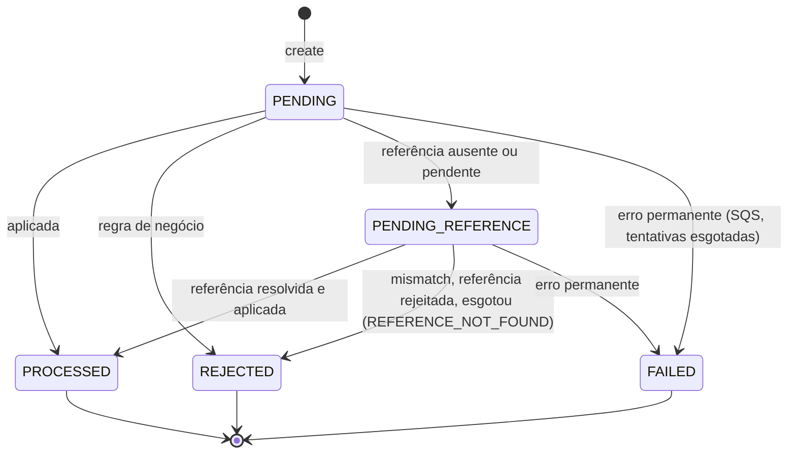

# 02 — Design

## 1. Arquitetura (ADR-0003, ADR-0004)

Hexagonal enxuta, sem CQRS nem event sourcing. Uma única base de código e **uma imagem**; cada instância executa todos os papéis (HTTP, consumidor SQS, publisher da outbox, worker de referências), com flags para desligar papéis.

```
src/
  main.ts                       bootstrap, shutdown hooks, flags de papel
  shared/                       Money, erros de domínio, Clock, ids (UUIDv7), config (Zod)
  modules/
    wallet/        domain/ (Wallet, WalletLedgerEntry)  application/ (CreateWallet, GetWallet, ListLedger, Reconcile)  infrastructure/ (EntitySchema, mappers, repositórios, controllers)
    wagering/      domain/ (WagerTransaction, políticas de kind/referência)  application/ (SubmitWagerTransaction, ProcessPendingReference, portas)  infrastructure/ (persistência, controllers, schemas Zod)
    messaging/     domain/ (InboxMessage, OutboxMessage, IntegrationEvent + 5 eventos)  application/ (portas MessagePublisher/MessageConsumer)  infrastructure/ (SQS, poller, publisher, workers, breaker)
    platform/      health, métricas, logging, contexto de correlação, auth no-op, ProblemDetails filter
```

Regras de dependência: `domain` não importa nada de fora (nem ORM, nem Nest); `application` depende de `domain` e de **portas** (interfaces); `infrastructure` implementa portas. Verificado por teste de arquitetura (TST-U-13).

## 2. Modelo de domínio

Construtores `private`; fábricas `create` / `open` / `rehydrate` (a reidratação **não** revalida transições). Persistência usa **EntitySchema + mappers** (domínio puro ↔ modelo de dados), sem decorators no domínio.

- **Money** (`big.js` internamente, escala 2): `from`, `zero`, `add`, `subtract`, `negate`, `isZero`, `isPositive`, `isNegative`, `isLessThan`, `equals`, `toJSON`, `toString`. Regex de entrada `^\d+\.\d{2}$` (máx. 17 dígitos inteiros). Nunca construído de `number`; serialização sempre `toFixed(2)`.
- **Wallet** (agregado): `open`, `rehydrate`, `debit(money, transactionId, now): WalletLedgerEntry` (lança `InsufficientFundsError`), `credit(...)`. `version` só sobe quando o saldo muda. Abertura com saldo inicial: `version = 1` e entrada `OPENING` com `wallet_version = 1`.
- **WagerTransaction**: campos do enunciado + extensões documentadas: `observedBalance`, `referenceAttempts`, `nextAttemptAt`. Métodos: `create`, `rehydrate`, `markProcessed`, `markPendingReference`, `reject(code)`, `fail(code)`, `isTerminal`, `affectsBalance` (false para `LOSS`), `requiresReference` (`REFUND`/`ROLLBACK`), `matchesPayload`, `ledgerDirectionFor(reference?)`.
- **WalletLedgerEntry**: sem setters nem transições; `create` valida `balanceBefore ± money === balanceAfter`.
- **InboxMessage / OutboxMessage / IntegrationEvent<T>**: conforme §6.5 e §11 do enunciado; `OutboxMessage` ganha `failedAt`/`lastError` (`publish_failed`) e `groupKey`.

**Direção do lançamento:** `OPENING`/`WIN`/`REFUND` → CREDIT; `BET` → DEBIT; `ROLLBACK` → inverso da referência (`BET`→CREDIT, `WIN`→DEBIT, `REFUND`→DEBIT).

## 3. Máquina de estados de `WagerTransaction`


Uma nova tentativa de `PENDING_REFERENCE` que continua pendente **não é transição**: incrementa `reference_attempts` e reagenda `next_attempt_at`.

## 4. Schema (PostgreSQL) — ADR-0006, 0008, 0009, 0010

Convenções: `snake_case`, ids UUIDv7 gerados na aplicação, `timestamptz` (UTC), `text` para chaves e hashes, enums como `text + CHECK` (migrations mais simples). Dinheiro: `numeric(19,2)`.

```sql
CREATE TABLE wallets (
  id          uuid PRIMARY KEY,
  player_id   uuid NOT NULL,
  currency    text NOT NULL CHECK (currency ~ '^[A-Z]{3}$'),
  balance     numeric(19,2) NOT NULL,
  version     integer NOT NULL DEFAULT 1,
  created_at  timestamptz NOT NULL,
  updated_at  timestamptz NOT NULL,
  CONSTRAINT wallets_balance_non_negative CHECK (balance >= 0),
  CONSTRAINT wallets_version_positive     CHECK (version >= 1),
  CONSTRAINT wallets_player_currency_uk   UNIQUE (player_id, currency)
);

CREATE TABLE wager_transactions (
  id                                uuid PRIMARY KEY,
  provider_id                       text NOT NULL,
  external_transaction_id           text NOT NULL,
  idempotency_key                   text NOT NULL,
  payload_hash                      text NOT NULL,
  wallet_id                         uuid NOT NULL REFERENCES wallets(id),
  player_id                         uuid NOT NULL,
  round_id                          text NOT NULL,
  game_id                           text NOT NULL,
  kind        text NOT NULL CHECK (kind IN ('OPENING','BET','WIN','LOSS','REFUND','ROLLBACK')),
  amount      numeric(19,2) NOT NULL CHECK (amount > 0),
  currency    text NOT NULL CHECK (currency ~ '^[A-Z]{3}$'),
  status      text NOT NULL CHECK (status IN ('PENDING','PENDING_REFERENCE','PROCESSED','REJECTED','FAILED')),
  reference_external_transaction_id text NULL,
  reference_transaction_id          uuid NULL REFERENCES wager_transactions(id),
  failure_code                      text NULL,
  observed_balance                  numeric(19,2) NULL,
  reference_attempts                integer NOT NULL DEFAULT 0,
  next_attempt_at                   timestamptz NULL,
  created_at                        timestamptz NOT NULL,
  processed_at                      timestamptz NULL,
  updated_at                        timestamptz NOT NULL,
  CONSTRAINT wt_idempotency_uk  UNIQUE (provider_id, idempotency_key),
  CONSTRAINT wt_external_id_uk  UNIQUE (provider_id, external_transaction_id),
  CONSTRAINT wt_ref_required    CHECK (kind NOT IN ('REFUND','ROLLBACK') OR reference_external_transaction_id IS NOT NULL),
  CONSTRAINT wt_ref_forbidden   CHECK (kind NOT IN ('BET','OPENING') OR reference_external_transaction_id IS NULL),
  CONSTRAINT wt_failure_code    CHECK ((status IN ('REJECTED','FAILED')) = (failure_code IS NOT NULL)),
  CONSTRAINT wt_processed_at    CHECK ((status = 'PROCESSED') = (processed_at IS NOT NULL)),
  CONSTRAINT wt_pending_ref     CHECK (status <> 'PENDING_REFERENCE' OR next_attempt_at IS NOT NULL)
);
-- uma reversão PROCESSED por transação referenciada (ADR-0010)
CREATE UNIQUE INDEX wt_one_reversal_per_reference
  ON wager_transactions (reference_transaction_id)
  WHERE kind IN ('REFUND','ROLLBACK') AND status = 'PROCESSED';
CREATE INDEX wt_pending_due     ON wager_transactions (next_attempt_at) WHERE status = 'PENDING_REFERENCE';
CREATE INDEX wt_pending_by_ref  ON wager_transactions (provider_id, reference_external_transaction_id, wallet_id) WHERE status = 'PENDING_REFERENCE';

CREATE TABLE wallet_ledger_entries (
  id             uuid PRIMARY KEY,
  wallet_id      uuid NOT NULL REFERENCES wallets(id),
  transaction_id uuid NOT NULL REFERENCES wager_transactions(id),
  wallet_version integer NOT NULL,
  direction      text NOT NULL CHECK (direction IN ('DEBIT','CREDIT')),
  amount         numeric(19,2) NOT NULL CHECK (amount > 0),
  currency       text NOT NULL,
  balance_before numeric(19,2) NOT NULL CHECK (balance_before >= 0),
  balance_after  numeric(19,2) NOT NULL CHECK (balance_after >= 0),
  created_at     timestamptz NOT NULL,
  CONSTRAINT le_arithmetic CHECK (
    (direction = 'CREDIT' AND balance_after = balance_before + amount) OR
    (direction = 'DEBIT'  AND balance_after = balance_before - amount)),
  CONSTRAINT le_one_per_tx   UNIQUE (wallet_id, transaction_id),
  CONSTRAINT le_version_uk   UNIQUE (wallet_id, wallet_version)
);

CREATE TABLE inbox_messages (
  consumer_name text NOT NULL,
  message_id    text NOT NULL,
  payload_hash  text NOT NULL,
  received_at   timestamptz NOT NULL,
  processed_at  timestamptz NULL,
  PRIMARY KEY (consumer_name, message_id)
);

CREATE TABLE outbox_messages (
  id              uuid PRIMARY KEY,            -- = eventId (estável nas republicações)
  aggregate_id    text NOT NULL,
  group_key       text NOT NULL,               -- SQS MessageGroupId (= walletId)
  event_type      text NOT NULL,
  payload         jsonb NOT NULL,              -- envelope serializado (dinheiro como string)
  occurred_at     timestamptz NOT NULL,
  attempts        integer NOT NULL DEFAULT 0,
  next_attempt_at timestamptz NOT NULL,
  published_at    timestamptz NULL,
  failed_at       timestamptz NULL,            -- publish_failed (erro permanente)
  last_error      text NULL,
  CONSTRAINT ob_final_exclusive CHECK (published_at IS NULL OR failed_at IS NULL)
);
CREATE INDEX ob_publishable ON outbox_messages (occurred_at) WHERE published_at IS NULL AND failed_at IS NULL;
```

**Triggers de imutabilidade (ADR-0009):**

```sql
CREATE FUNCTION ledger_append_only() RETURNS trigger LANGUAGE plpgsql AS $$
BEGIN RAISE EXCEPTION 'wallet_ledger_entries is append-only (%)', TG_OP; END $$;
CREATE TRIGGER ledger_no_row_change BEFORE UPDATE OR DELETE ON wallet_ledger_entries
  FOR EACH ROW EXECUTE FUNCTION ledger_append_only();
CREATE TRIGGER ledger_no_truncate BEFORE TRUNCATE ON wallet_ledger_entries
  FOR EACH STATEMENT EXECUTE FUNCTION ledger_append_only();

CREATE FUNCTION wager_transactions_guard() RETURNS trigger LANGUAGE plpgsql AS $$
BEGIN
  IF TG_OP = 'DELETE' THEN RAISE EXCEPTION 'wager_transactions cannot be deleted'; END IF;
  IF OLD.status IN ('PROCESSED','REJECTED','FAILED') THEN
    RAISE EXCEPTION 'terminal wager_transactions are immutable';
  END IF;
  IF (NEW.id, NEW.provider_id, NEW.external_transaction_id, NEW.idempotency_key, NEW.payload_hash,
      NEW.wallet_id, NEW.player_id, NEW.round_id, NEW.game_id, NEW.kind, NEW.amount, NEW.currency,
      NEW.reference_external_transaction_id, NEW.created_at)
     IS DISTINCT FROM
     (OLD.id, OLD.provider_id, OLD.external_transaction_id, OLD.idempotency_key, OLD.payload_hash,
      OLD.wallet_id, OLD.player_id, OLD.round_id, OLD.game_id, OLD.kind, OLD.amount, OLD.currency,
      OLD.reference_external_transaction_id, OLD.created_at) THEN
    RAISE EXCEPTION 'wager_transactions identity columns are immutable';
  END IF;
  RETURN NEW;
END $$;
CREATE TRIGGER wt_guard BEFORE UPDATE OR DELETE ON wager_transactions
  FOR EACH ROW EXECUTE FUNCTION wager_transactions_guard();
```

**`down` das migrations:** `DROP TABLE` não dispara os triggers de linha. Qualquer `down` que **apague linhas** do ledger ou de transações terminais precisa desabilitar o trigger antes (`ALTER TABLE … DISABLE TRIGGER …`). Testado com ledger populado (TST-I-01). A limpeza entre testes **não** usa `TRUNCATE` (ver 05-test-plan §2).

## 5. Algoritmo de `SubmitWagerTransaction` (ADR-0007)

Entrada: comando validado (Zod) + canal (`HTTP` | `SQS` com `messageId`) + `correlationId`. O `payloadHash` é calculado antes de qualquer acesso ao banco.

```mermaid
sequenceDiagram
    participant C as Caller (HTTP/SQS)
    participant U as Use case
    participant DB as PostgreSQL
    C->>U: comando (+ Idempotency-Key)
    opt canal HTTP (fast path, sem lock)
        U->>DB: SELECT por (provider, idempotency_key)
        DB-->>U: existe? → replay ou 409 (fim)
    end
    U->>DB: BEGIN; SET LOCAL lock_timeout, statement_timeout
    opt canal SQS
        U->>DB: INSERT inbox ON CONFLICT DO NOTHING (1º recurso)
        Note over U,DB: já existe → ack sem processar; payload_hash diferente → DLQ
    end
    U->>DB: SELECT wallet FOR UPDATE (2º recurso)
    Note over U,DB: não existe → WALLET_NOT_FOUND (rollback)
    U->>DB: INSERT wager_transactions(PENDING) ON CONFLICT DO NOTHING (3º recurso)
    Note over U,DB: sem linha inserida → relê: mesma chave+hash = replay; hash diferente = 409; só id externo igual = 409
    U->>DB: resolve referência (leitura sem lock, sem filtro de wallet)
    U->>U: domínio decide (debit/credit/reject/pending)
    U->>DB: UPDATE wallet (WHERE id AND version = esperada) + INSERT ledger + UPDATE transação + INSERT outbox + acordar dependentes + inbox processed
    U->>DB: COMMIT
    U-->>C: resultado (ack só aqui, se SQS)
```

**Ordem de verificação das regras (determinística):**
1. Wallet: `playerId` e moeda batem → senão `REJECTED` (`WALLET_PLAYER_MISMATCH`, `WALLET_CURRENCY_MISMATCH`).
2. Se há `referenceExternalTransactionId`: buscar por (`providerId`, ref) **sem filtro de wallet**.
   - não existe → `PENDING_REFERENCE`;
   - kind não permitido (`REFUND`→só `BET`; `ROLLBACK`→`BET|WIN|REFUND`; `WIN`/`LOSS`→só `BET`) → `REFERENCE_KIND_NOT_ALLOWED`;
   - wallet/player/moeda/rodada divergem → `REFERENCE_MISMATCH`;
   - reversão com valor ≠ referência → `REVERSAL_AMOUNT_MISMATCH`;
   - referência `PENDING_REFERENCE` → esta também `PENDING_REFERENCE`;
   - referência `REJECTED`/`FAILED` → `REFERENCE_NOT_PROCESSED`;
   - referência já tem reversão `PROCESSED` → `REFERENCE_ALREADY_REVERSED`.
3. Aplicar: `BET` sem saldo → `INSUFFICIENT_FUNDS`; reversão que ficaria negativa → `REVERSAL_WOULD_OVERDRAW`.
4. Acordar dependentes: `UPDATE wager_transactions SET next_attempt_at = now() WHERE status='PENDING_REFERENCE' AND provider_id=$p AND reference_external_transaction_id=$ext AND wallet_id=$W` (restrito à wallet travada).

O caso de uso do worker (`ProcessPendingReference`) reaproveita os passos 2–4 e o domínio; difere só em como obtém a transação (locka a wallet e depois relê a linha com `FOR UPDATE`, revalidando status e vencimento).

## 6. Ordem canônica de locks (ADR-0007) — **não alterar sem consultar o autor**

**(1) inbox → (2) lock da wallet (`FOR UPDATE`) → (3) linhas e índices de `wager_transactions`.** Nenhuma transação adquire um recurso de nível menor depois de um de nível maior. Por haver ordem total, não há ciclo. Vale para HTTP, consumidor, worker de referências e reconciliação (esta lê em snapshot, sem lock).

Por quê: um `INSERT` em `wager_transactions` toma `FOR KEY SHARE` na wallet (FK), que conflita com `FOR UPDATE`; inserir antes de travar a wallet permite que duas transações segurem `KEY SHARE` e peçam `FOR UPDATE`, formando um deadlock.

Se mesmo assim o Postgres detectar deadlock (`40P01`), é falha **transitória**.

Regra de leitura: **toda decisão que depende do saldo lê a wallet com `FOR UPDATE`**. Exceções: consultas `GET` e reconciliação (relatórios, não decisões).

## 7. Isolamento e defesas em profundidade (ADR-0006)

`READ COMMITTED` + locks explícitos + constraints. Defesas: `UPDATE wallets … WHERE id = $1 AND version = $esperada` (assert; se 0 linhas é bug, **sem retry**), `CHECK (balance >= 0)`, `UNIQUE (wallet_id, wallet_version)`, `lock_timeout`, `statement_timeout`.

## 8. Configuração (Zod, validada no boot)

| Variável | Padrão | Uso |
|---|---|---|
| `ENABLE_HTTP` / `ENABLE_CONSUMER` / `ENABLE_OUTBOX_PUBLISHER` / `ENABLE_PENDING_WORKER` | `true` | Papéis da instância |
| `DB_POOL_MAX` | 10 | Conexões por instância |
| `LOCK_TIMEOUT_MS` / `STATEMENT_TIMEOUT_MS` | 5000 / 15000 | Timeouts por transação |
| `PENDING_REF_MAX_ATTEMPTS` / `_BASE_MS` / `_FACTOR` / `_CAP_MS` | 6 / 5000 / 2 / 300000 | Backoff de referências |
| `PENDING_REF_POLL_MS` / `_CONCURRENCY` | 1000 / 5 | Worker |
| `OUTBOX_BATCH` / `OUTBOX_POLL_MS` / `OUTBOX_BACKOFF_BASE_MS` / `_CAP_MS` | 10 / 500 / 1000 / 60000 | Publisher |
| `SQS_MAX_RECEIVE` / `SQS_HANDLER_TIMEOUT_MS` / `SQS_CONCURRENCY` | 8 / 20000 / 5 | Consumidor |
| `SQS_BACKOFF_BASE_S` / `SQS_BACKOFF_CAP_S` | 2 / 30 | Visibilidade em falha transitória |
| `BREAKER_COOLDOWN_MIN_MS` / `_MAX_MS` | 1000 / 30000 | Circuit breaker |
| `SHUTDOWN_GRACE_MS` | 20000 | Espera por handlers no SIGTERM |
| `TEST_FAULT` | vazio | Injeção de falha; **recusada** se `NODE_ENV=production` |

## 9. Infraestrutura local

`docker-compose.yml`: `postgres` (versão fixa), emulador SQS (R-01), `app1`, `app2`, `app3` (mesma imagem, portas 3001–3003, `stop_grace_period: 30s`). Filas criadas por script idempotente: `wager-transactions.fifo` (visibilidade 30 s, long polling 20 s, redrive `maxReceiveCount=8` → `wager-transactions-dlq.fifo`) e `wager-events.fifo`. Compose de teste separado (`docker-compose.test.yml`): um Postgres e um emulador compartilhados por todas as suítes.
