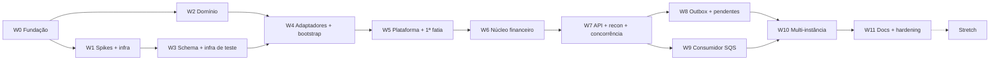

# 07 — Plano de execução em ondas

> Criado em 2026-10-27 (terça). Entrega: **sexta 30/10**. Este plano não altera nenhuma decisão: só agrupa e ordena as tarefas de [06-tasks.md](06-tasks.md) em sessões independentes (ondas), cada uma com prompt, gate e relatório. Protocolo comum: [waves/_common.md](waves/_common.md).

## 1. Decisões de planejamento (todas do autor, 2026-10-27)

| # | Decisão | Efeito |
|---|---|---|
| D1 | Janela: **qua + qui + sex inteiros**, mais a noite de hoje para começar | Calendário em §3 |
| D2 | **Sequencial com uma única janela paralela** (trilha A de infra ∥ trilha B de domínio) | §5 |
| D3 | **Código, `failureCode`/`errorCode` e logs em inglês; docs e descrição dos commits em PT-BR** (ajustado pelo autor após o plano; tipo e escopo do Conventional Commit seguem o padrão) | `CLAUDE.md` corrigido |
| D4 | Dividir **T-031→a/b**, **T-042→a/b**, **T-005→a/b** | `06-tasks.md` atualizado |
| D5 | Dividir **T-025→a/b** (infra de teste antes das migrations; `assertLedgerInvariant` depois dos repositórios) | idem |
| D6 | Nova **T-026 Bootstrap Nest** (dona de `main.ts`, `AppModule`, flags `ENABLE_*`, hooks de shutdown) | idem |

Assumidos por padrão (sem veto): T-050/T-051/T-054 antecipadas para antes de M3; T-045 antecipada para a W3; `assertLedgerInvariant` vira SQL em snapshot reaproveitado pela reconciliação; gate de onda automatizado com relatório de evidência e **prova de dentes** (mutação que o teste precisa detectar); ondas de stretch também têm prompt, sempre com rodada de decisão antes do código. Defaults de detalhes não definidos na spec estão marcados "veto do autor" em §7 (N16, N18) e nos arquivos das ondas.

Total: **47 tarefas** (42 originais + 5 pelos cortes e pela T-026), em **12 ondas** (W0–W11) + 6 prompts de stretch.

## 2. Tabela de ondas

Tamanho = estimativa grosseira de tempo de sessão, **sem** contar a sua revisão: P ≤ 1,5 h · M 2–3 h · G 3–5 h.

| Onda | Nome | Tarefas | Depende de | Branch | Tam. | Prompt |
|---|---|---|---|---|---|---|
| W0 | Fundação | prep + T-001 | — | `main` | P | [W0](waves/W0-fundacao.md) |
| W1 | Spikes e infra base | T-002, T-003, T-004, T-005a, T-006 | W0 | `wave/w1` (worktree) | M | [W1](waves/W1-spikes-e-infra-base.md) |
| W2 | Domínio puro | T-010 … T-016 | W0 | `wave/w2` (worktree) | M | [W2](waves/W2-dominio-puro.md) |
| W3 | Schema e infra de teste | T-020, T-025a, T-021, T-022, T-023, T-045 | W1 | `wave/w3` | M | [W3](waves/W3-schema-e-infra-de-teste.md) |
| W4 | Adaptadores, invariante e bootstrap | T-024, T-025b, T-026 | W2 + W3 | `wave/w4` | G | [W4](waves/W4-adaptadores-invariante-bootstrap.md) |
| W5 | Plataforma e primeira fatia | T-050, T-051, T-054, T-030 | W4 | `wave/w5` | M | [W5](waves/W5-plataforma-e-primeira-fatia.md) |
| W6 | Núcleo financeiro | T-031a, T-031b, T-032 | W5 | `wave/w6` | G | [W6](waves/W6-nucleo-financeiro.md) |
| W7 | API, consultas, reconciliação e concorrência | T-033, T-034, T-035, T-036 | W6 | `wave/w7` | G | [W7](waves/W7-api-reconciliacao-concorrencia.md) |
| W8 | Outbox e referências pendentes | T-040, T-043 | W7 | `wave/w8` | M | [W8](waves/W8-outbox-e-referencias-pendentes.md) |
| W9 | Consumidor SQS | T-041, T-042a, T-042b, T-044 | W7 (independe da W8) | `wave/w9` | G | [W9](waves/W9-consumidor-sqs.md) |
| W10 | Multi-instância e ciclo de vida | T-052, T-046, T-053, T-005b (nesta ordem) | W8 + W9 | `wave/w10` | G | [W10](waves/W10-multi-instancia-e-ciclo-de-vida.md) |
| W11 | Documentação e hardening | T-060, T-061, T-062, T-063 | W10 | `wave/w11` | M | [W11](waves/W11-docs-e-hardening.md) |
| WS | Stretch (opcional) | S-01 … S-06 | W11 (ou W10 se sobrar tempo) | uma por item | — | [WS](waves/WS-stretch.md) |

Soma estimada: ~36 h de sessão (menos ~2,5 h de sobreposição da janela paralela). **A folga real é próxima de zero**; por isso existem os checkpoints e a linha de corte (§6).

## 3. Calendário e checkpoints

| Quando | Ondas | Checkpoint (você decide) |
|---|---|---|
| **Ter noite** | W0; iniciar W1 e W2 em paralelo se houver fôlego | CP0: `main` com specs, scaffold e `typecheck/lint/test:unit` verdes |
| **Qua** | W1 ∥ W2 → merge → W3 → W4 | **CP1 (fim de qua):** W4 mergeada (M0, M1 e M2 completas, bootstrap no ar). Se não: Qui perde uma onda e a linha de corte §6 já vale |
| **Qui** | W5 → W6 → W7 → W8 | **CP2 (fim de qui):** W7 verde (core financeiro, API e concorrência provados). W8 verde ou quase |
| **Sex** | W9 → W10 → W11 | **CP3 (meio da sex):** W9 verde; senão corta T-044. **CP4 (congelamento de código):** W10 verde, só docs depois |

Observação sobre o corte interno: pela recomendação inicial o código congelaria na quinta à noite, mas o conteúdo de M4 (W9 e W10) só cabe na sexta. O congelamento real vira "W10 verde", e a sexta à tarde fica para W11. Se CP2 estiver atrasado, a primeira alavanca é a segunda janela paralela (§5, contingência).

## 4. Grafo de dependências



Trilha A = W1 → W3. Trilha B = W2. Elas só se encontram em W4. W8 e W9 são independentes entre si e só se encontram em W10; a ordem W8 → W9 prioriza o outbox e o worker de pendentes (o consumidor é o item com mais risco de emulador e fica mais perto do corte, §6).

## 5. Janela paralela (W1 ∥ W2)

Única janela paralela do plano. As duas trilhas escrevem em pastas disjuntas (infra e scripts × `src/shared` e `src/modules/*/domain`).

```bash
# a partir da main, depois do W0
git worktree add ../backend-challenge-w1 -b wave/w1
git worktree add ../backend-challenge-w2 -b wave/w2
# uma sessão Claude Code em cada pasta
```

- **Merge** (feito por você): `git merge --no-ff wave/w1` e depois `wave/w2`. Pontos de conflito esperados: `package.json` (dependências, trivial) e `bun.lock` (apague e rode `bun install`). `06-tasks.md` não conflita, pois cada onda marca linhas diferentes.
- **W3** nasce da `main` já com W1 mergeada (pode rodar enquanto W2 ainda termina). **W4 só começa com W1, W2 e W3 mergeadas.**
- O hook de commitlint nasce em W1 (T-004/T-006). Os commits de W2 anteriores ao merge seguem o formato por disciplina; rode `bunx commitlint --from main` depois do merge para conferir.
- Depois do merge: `git worktree remove ../backend-challenge-w1` (idem w2).

**Contingência (não faz parte do baseline, exige seu OK):** se CP2 estiver atrasado, W8 ∥ W9 em worktrees. São independentes e tocam módulos diferentes (`outbox/pending-worker` × `consumer/breaker`). O custo é revisão simultânea.

## 6. Linha de corte (só com sua aprovação no checkpoint)

Ordem do que cortar se o relógio apertar, do menos para o mais doloroso. Tudo que for cortado vira **limitação documentada** em `ARCHITECTURE.md`.

1. Todo o stretch (já fora do baseline).
2. **T-044 circuit breaker** e TST-I-20: é decisão do ADR-0015, não exigência do enunciado. Sem ele, queda do banco consome tentativas de recebimento.
3. Profundidade de **T-052**: `ready` só com Postgres + SQS (sem os casos breaker e shutdown).
4. **T-062**: matriz de rastreabilidade enxuta (só áreas pontuadas).

**Não cortar** (eliminatório ou alto peso): W2–W7, T-040, T-041, T-042a/b, T-043, T-045, T-046 (C-04, C-05, C-08), T-053, T-005b, T-060, T-061.

## 7. Fronteiras entre tarefas (resolvem lacunas sem alterar spec)

| # | Fronteira | Onde fecha |
|---|---|---|
| N1 | `TST-I-06`/`I-07` se dividem: **nível do caso de uso** (status de domínio, ledger, outbox, replay) em T-031a/b e T-032; **nível HTTP** (códigos de status, problem+json, headers) em T-033 | W6 / W7 |
| N2 | O ramo SQS/inbox do `SubmitWagerTransaction` nasce em **T-042a**, não em T-031 | W9 |
| N3 | T-030 introduz o `ProblemDetailsFilter` com os `errorCode` de que precisa (`VALIDATION_ERROR`, `WALLET_ALREADY_EXISTS`, `WALLET_NOT_FOUND`, `SERVICE_UNAVAILABLE`, `INTERNAL_ERROR`); T-033 completa o catálogo e consolida o pipe Zod | W5 / W7 |
| N4 | `TST-C-01`: metade HTTP em T-036; metade SQS em T-042a (consumidor em processo) | W7 / W9 |
| N5 | `TST-C-06`: (a) dois publishers concorrentes em processo em T-040; (b) publisher morto após enviar e antes do commit, com `Bun.spawn`, em T-046 | W8 / W10 |
| N6 | `TEST_FAULT`: T-045 é antecipada para W3 (só depende de T-020) e inclui a recusa em produção na config. Os pontos de gancho ficam com quem os possui: `fail-mid-transaction` em T-031a, `crash-after-publish-before-commit` em T-040, `crash-after-commit-before-ack` em T-041 | W3 / W6 / W8 / W9 |
| N7 | T-001 deixa `typecheck`, `lint` (Biome baseline) e `test:unit` (com um teste de fumaça) executáveis, para a trilha de domínio poder lintar. T-004 apenas valida e ajusta as regras | W0 / W1 |
| N8 | `TST-U-10` (backoff de referências) é entregue em **T-032**, que precisa calcular o primeiro `next_attempt_at` ao gravar `PENDING_REFERENCE`; T-043 reutiliza a função | W6 |
| N9 | `Clock` e gerador de ids ficam em `src/shared`, criados por quem precisa primeiro (T-011). UUIDv7 via `Bun.randomUUIDv7()` (sem dependência) | W2 |
| N10 | T-051 registra **todas** as métricas do `04-api §7` de uma vez (valor zero) e `/metrics` as expõe; cada tarefa seguinte incrementa a sua. `TST-I-17` fecha em T-051 e é reconferido em W10 | W5 / W10 |
| N11 | `assertLedgerInvariant` é obrigatório ao final de todo teste que toca wallet **a partir de T-025b**. Testes de migration de W3 estão isentos (não há fluxo de wallet) | W4 em diante |
| N12 | Spikes deixam scripts reproduzíveis em `spikes/` e o resultado em `adr/0002-spike.md` | W1 |
| N13 | O commit `docs(waves): adiciona relatório da W<n>` ao fim de cada onda é a única exceção ao "um commit por tarefa" | todas |
| N14 | A tradução dos erros do `pg` para tipos de aplicação (`TransientPersistenceError`, `InfrastructureUnavailableError`) nasce no `TransactionManager` (T-024); a classificação do consumidor (T-042a) e o 503 (T-033) são feitos por cima desses tipos | W4 |
| N15 | O middleware de `X-Correlation-Id` nasce em T-050 (precisa do `AsyncLocalStorage`); T-033 só testa o contrato HTTP | W5 / W7 |
| N16 | **Default adotado (veto do autor):** colunas `NOT NULL` do `OPENING` sem valor na spec: `round_id = 'opening'`, `game_id = 'system'`, `payload_hash` = hash canônico dos campos do `OPENING` | W5 |
| N17 | T-052 cria o estado de ciclo de vida (`accepting`/`draining`) que a readiness consulta; T-053 o aciona no `SIGTERM`. Por isso a ordem da W10 é T-052 → T-046 → T-053 → T-005b | W10 |
| N18 | **Default adotado (veto do autor):** `limit` fora de 1..200 no ledger → 400 `VALIDATION_ERROR`; forma do `GET` de transação = envelope de resultado + identificadores | W7 |
| N19 | `README.md` da raiz é o enunciado do desafio e é citado pelas specs: a T-060 **preserva** o enunciado e acrescenta a seção do candidato (forma menos invasiva; a sessão reporta ou pergunta) | W11 |

## 8. Cobertura de testes por onda

| ID | Onda | | ID | Onda | | ID | Onda |
|---|---|---|---|---|---|---|---|
| U-01, U-02 | W2 | | I-01 … I-04 | W3 | | C-01 | W7 (HTTP) + W9 (SQS) |
| U-03, U-07 | W2 | | I-05 | W6 | | C-02 | W7 |
| U-04, U-05 | W2 | | I-06, I-07 | W6 (caso de uso) + W7 (HTTP) | | C-03 | W7 |
| U-06 | W2 | | I-08, I-09 | W6 | | C-04 | W10 |
| U-08, U-09 | W2 | | I-10 | W8 | | C-05 | W10 |
| U-10 | W6 | | I-11, I-12 | W9 | | C-06 | W8 (a) + W10 (b) |
| U-11 | W9 | | I-13 | W8 | | C-07 | W8 |
| U-12 | W5 | | I-14 | W4 (invariante) + W7 | | C-08 | W10 |
| U-13 | W2 | | I-15 | W7 | | C-09 | W7 |
| | | | I-16 | W10 | | C-10 | W10 |
| | | | I-17 | W5 + W10 | | C-11 | W7 |
| | | | I-18 | W10 | | C-12 | W7 |
| | | | I-19 | W5 | | | |
| | | | I-20 | W9 | | | |

Todos os 13 unitários, 20 de integração e 12 de concorrência do [05-test-plan.md](05-test-plan.md) estão alocados.

## 9. Peso na avaliação × onda

| Área (pts) | Ondas que a sustentam |
|---|---|
| Correção financeira (20) | W2, W6, W7 (reconciliação) |
| Concorrência (20) | W6, W7 (T-036), W10 (T-046) |
| Idempotência (15) | W6 (T-031b), W7, W9 (T-042a) |
| Mensageria e falhas (15) | W8, W9, W10 |
| Modelagem e arquitetura (10) | W2, W4 |
| Testes (10) | W3 (T-025a), todas, W10 |
| Observabilidade (5) | W5, W10 (T-052) |
| Documentação (5) | W11 |

## 10. Como conduzir cada onda

1. Confira as pré-condições da onda anterior no relatório dela (`waves/reports/`).
2. Abra uma sessão Claude Code **dentro do WSL**, na pasta (ou worktree) da onda, e cole o prompt que está no topo do arquivo da onda.
3. A sessão trabalha, roda o gate e escreve o relatório. Você lê o **relatório**, não refaz o trabalho: confira o veredito, os IDs exigidos × encontrados, as provas de dentes e os desvios.
4. Merge na `main` (você), marque a onda aqui e siga.

| Onda | Status |
|---|---|
| W0 … W11, WS | ☐ nenhuma iniciada |

## 11. O que esta sessão de planejamento mudou nas specs

- `06-tasks.md`: T-005→a/b, T-025→a/b, T-031→a/b, T-042→a/b, nova T-026, nota sobre ondas e matriz atualizada.
- `CLAUDE.md`: idioma (código e logs em inglês; commits em português) e ponteiro para as ondas.
- `specs/README.md`: índice com `07-waves.md`.
- Novos: este arquivo, `waves/_common.md`, `waves/W*.md`.
- Nenhum ADR, requisito, decisão ou a ordem de locks foi alterado.
